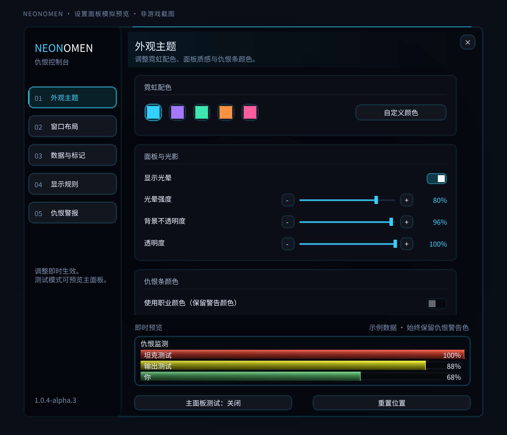

# NeonOmen

A threat meter for World of Warcraft Forever, customized with a neon-style interface and English, Traditional Chinese, and Simplified Chinese text.

## Features

- Threat bars, configurable warnings, and optional threat per second.
- Customizable theme color, glow, and window background opacity.
- Test mode for previewing the display.
- A low-layer meter that stays below system settings and dialogs.
- NeonCast-inspired dark tracks, shaded fills, restrained glow and a clear progress edge.
- A NeonCast-style settings console with five pages, accent presets, styled controls and live sample bars.

## Installation

Extract the installation package and copy its `NeonOmen` directory into
`Interface/AddOns/NeonOmen`. The TOC must be at `Interface/AddOns/NeonOmen/NeonOmen.toc`.
The Actions artifact also extracts directly to this directory, without a nested ZIP.

Use `/neonomen` (or `/orf`) to open settings and `/orf test` to toggle test mode.

`1.0.4-alpha.3` is a development build awaiting verification in the Forever client.

The settings console opens directly from `/neonomen`, `/orf` or the minimap button.
The system settings category also provides a button to open it. Appearance, window
layout, data labels, visibility and alerts have separate pages; their options scroll
independently while the sample preview remains visible. The five accent presets
match NeonCast. Sample bars do not enable the main meter's test mode; use the
separate test button when positioning the meter.

### Upgrading from the old folder name

Exit the game before moving saved settings. Back up
`WTF/Account/<account>/SavedVariables/OmenReloadedForever.lua`, then copy it to
`WTF/Account/<account>/SavedVariables/NeonOmen.lua`. If a `NeonOmen.lua` settings file
already exists, back it up before replacing it. The contents must retain the
`OmenReloadedForeverDB` variable name; the new addon still uses that key.

Install the new `NeonOmen` directory and remove the old
`Interface/AddOns/OmenReloadedForever` addon directory. Then start the game.
Without the settings-file copy, the renamed addon starts with defaults; the old
settings file remains available for later migration. Existing keybinding command
IDs and `/orf` are retained. See [Chinese upgrade steps](docs/UPGRADING.zh-CN.md).

## Development

Install `requirements-dev.txt` in a virtual environment, then run
`python -m pytest tests -q` and `python tools/package.py`.
See [the verification checklist](docs/DEVELOPMENT.md) before releasing a stable build.
Pull request checks upload the installable `NeonOmen/` directory as the
`NeonOmen-test-build` artifact. The local packaging tool creates a versioned ZIP
with the same top-level directory.

## Attribution and license

The original OmenReloadedForever addon identifies Cryptotaxi as its author. This repository contains the local customization of that addon. No license was included in the installed copy; redistribution rights have not been established. The neon card assets were copied from the local NeonCast project.
