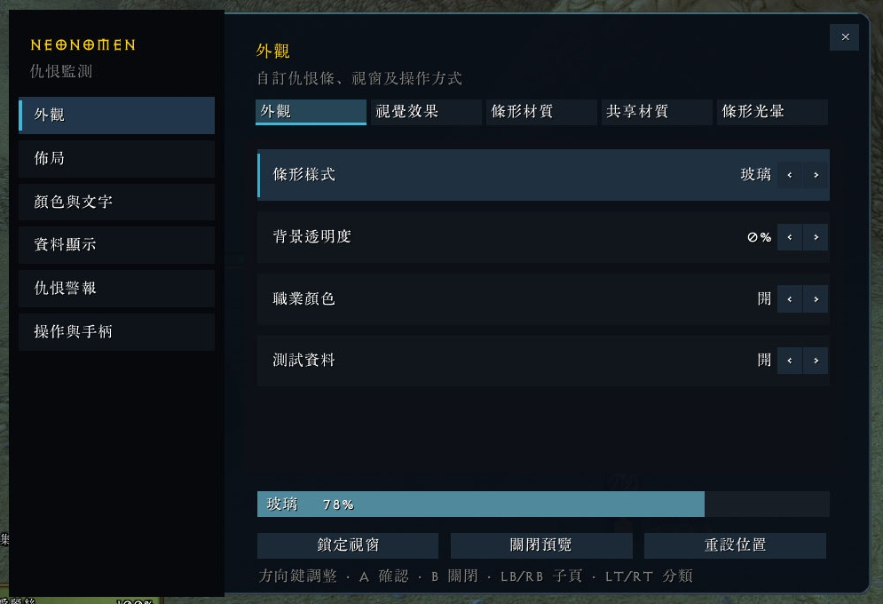

# NeonOmen

[English](README.md) | [简体中文](README.zh-CN.md)

An independently developed threat meter for **World of Warcraft Forever**
(Interface 16001). The project uses the MIT license. It neither loads the
previous NeonOmen addon nor automatically imports its settings.

Game screenshot: the settings window is shown with example data enabled.

## Usage

- `/nor` opens the settings window; `/nor test` toggles example data. Preview
  ends on entering combat or reloading so it cannot be mistaken for live data.
- `/nor lock` and `/nor unlock` control dragging; unlocking also turns off
  click-through so the window can be recovered.
- `/nor toggle` hides or shows the meter; `/nor reset` resets its position.
- `/nor debug` prints the current hostile target and player threat diagnostics
  to chat, marking restricted values as unavailable.
- Right-click the meter for quick access to locking, focus, TPS, preview and settings.
- Left-click the minimap button for settings, Shift-left-click to show or hide
  the meter, right-click for preview, and
  drag it to reposition it. Lock, preview and position controls are also
  available at the bottom of the settings window.

Settings provide bar materials, gradients and glow, role colors, opacity,
font and layout, automatic height, class and pet filters, visibility rules,
focus targets, TPS, a pull boundary when it can be calculated reliably, and
configurable warning sound, text, flash and meter shake. The boundary is only
displayed when readable client data distinguishes 110% from 130%.
Names can show a tank marker, a short-lived threat-transfer marker, and
dead/offline status; pet names have a localized suffix. Restricted names are
passed directly to the client and cannot be decorated.
Tank alert suppression recognizes an assigned tank role, defensive stance,
bear forms and Righteous Fury where the client allows those states to be read.
Built-in materials include rounded neon; fonts and bar textures registered
with LibSharedMedia are also available when another addon provides the library.
The controls page offers three independent profile slots that remember changes
when you switch between them.
Under Appearance → Bar glow, adjust each bar's halo intensity and spread
independently from the window glow.

With gamepad input enabled, the D-pad selects and changes settings, A
activates, B closes, LB/RB switches tabs within a category, and LT/RT switches categories. Navigation is
released during combat.

The client may restrict threat values in some encounters. Restricted names
and percentages are passed to display widgets where permitted, but cannot be
sorted, compared, or used to calculate TPS or a pull boundary. If the client
rejects a restricted value, the meter displays a placeholder. A readable
threat status can still trigger a warning.

This is a development build. Visual preview and settings have been checked in
the Forever client along with some live combat and physical controller navigation;
restricted values still need more live verification. Alerts can optionally shake the meter or game
world separately. World shake is off by default, skips protected frames and
restores the original position when permitted. Profiles use three numbered slots.

## Development

Run `python -m pytest -q` with `pytest` and `lupa` installed. These tests use a
mock WoW UI and do not replace testing in the game. See [LICENSE](LICENSE).
