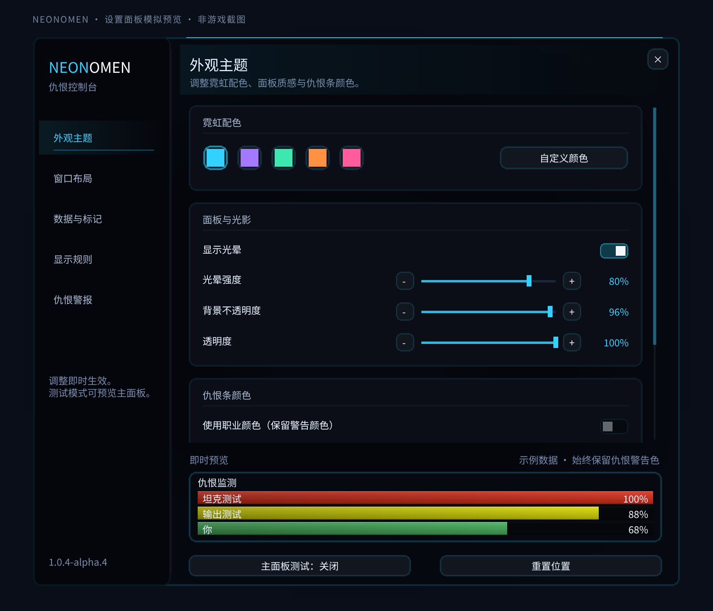

# NeonOmen — 魔兽世界永恒服仇恨监测插件

**NeonOmen 是面向 World of Warcraft Forever（魔兽世界永恒服）的独立仇恨监测插件。**
查看仇恨百分比、每秒仇恨（TPS）、队伍与团队仇恨变化，并按自己的界面搭配调整霓虹主题。
提供英文、简体中文和繁体中文界面。

[English](README.md) · [繁體中文](README.zh-TW.md) ·
[下载安装包](https://github.com/AreChen/NeonOmen/releases) ·
[反馈问题](https://github.com/AreChen/NeonOmen/issues)

## 仇恨监测与警报

- 显示仇恨百分比，可选原始仇恨值及最近 10 秒的 TPS。
- 支持队伍、团队、宠物、职业筛选、焦点目标优先检查和始终显示自己。
- 可配置仇恨警告阈值、提示音、屏幕边缘闪光、警告文字与屏幕震动。
- 使用职业颜色或自定义颜色时，仍保留仇恨警告色的优先级。
- 可分别设置单人、宠物、队伍、团队、战斗、休息区及 PvP 场景的显示规则。

## 外观与布局

- 五组主题配色，支持自定义颜色、光晕、背景不透明度及整体透明度。
- 仇恨条采用细横纹、顶部反光和直切末端，移除了会拉伸的胶囊圆角与末端竖线。
- 设置分为外观主题、窗口布局、数据与标记、显示规则、仇恨警报五页。
- 底部示例预览用于调整条面颜色与材质；主面板测试模式由独立按钮控制。
- 可调整宽度、高度、条目间距与缩放，支持向上排列、自动收拢、锁定及鼠标穿透。
- 主面板使用 LOW 层级，设置窗口独立显示，避免主面板遮挡系统设置。

当前版本为 **1.0.4-alpha.4 测试版**，实际显示及战斗行为仍需游戏内验证。
目标客户端为 **World of Warcraft Forever**；其他魔兽客户端版本尚未验证。

## 安装

1. 从 [GitHub Releases](https://github.com/AreChen/NeonOmen/releases) 下载版本对应的插件 ZIP。
2. 将压缩包里的 `NeonOmen` 文件夹放入游戏的 `Interface/AddOns` 目录。
3. 确认入口文件位于 `Interface/AddOns/NeonOmen/NeonOmen.toc`。
4. 输入 `/reload`，然后使用 `/neonomen` 或 `/orf` 打开设置。

安装包只有一层 `NeonOmen/`，仅包含运行文件。请下载发布页附带的版本 ZIP；
GitHub 自动生成的源码压缩包还包含开发文件。Actions 的 `NeonOmen-test-build`
产物也可以直接解压得到插件目录。

### 从旧目录升级并保留设置

完全退出游戏并备份配置，将
`WTF/Account/<账号>/SavedVariables/OmenReloadedForever.lua` 复制为同目录的
`NeonOmen.lua`。文件中的 `OmenReloadedForeverDB` 不用改名；如果已存在
`NeonOmen.lua`，先备份再决定是否覆盖。

安装新的 `Interface/AddOns/NeonOmen`，移除旧的
`Interface/AddOns/OmenReloadedForever` 插件目录。原有快捷键命令及 `/orf` 保留兼容。
详见[迁移说明](docs/UPGRADING.zh-CN.md)。

## 常用命令

| 命令 | 用途 |
| --- | --- |
| `/neonomen` 或 `/orf` | 打开设置 |
| `/orf test` | 切换主面板测试条 |
| `/orf toggle` | 显示或隐藏主面板 |
| `/orf lock` / `/orf unlock` | 锁定或解锁位置 |
| `/orf reset` | 重置位置与窗口尺寸 |
| `/orf debug` | 输出客户端及仇恨 API 诊断信息 |

小地图按钮也能打开设置。战斗中请求打开设置时，会在脱战后打开。

## 反馈与开发

请在 [GitHub Issues](https://github.com/AreChen/NeonOmen/issues) 提供插件版本、
客户端语言、复现步骤、Lua 报错，以及适用时的截图或 `/orf debug` 输出。
开发、打包及游戏内验证步骤见 [docs/DEVELOPMENT.md](docs/DEVELOPMENT.md)，
版本变化见 [CHANGELOG.md](CHANGELOG.md)。

原 OmenReloadedForever 插件署名作者为 **Cryptotaxi**，NeonOmen 定制由 **AreChen** 维护。
原始安装副本未附带许可证，本仓库尚未声明许可证；具体授权情况见英文说明的署名与许可证部分。
