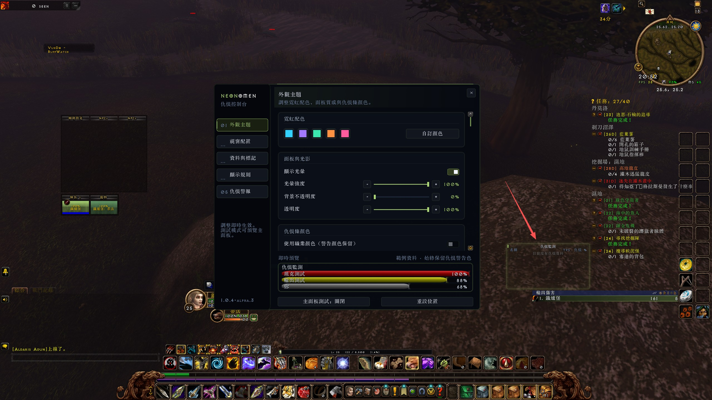

# NeonOmen — 魔獸世界永恆服仇恨監測插件

**NeonOmen 是為 World of Warcraft Forever（魔獸世界永恆服）設計的獨立仇恨監測插件。**
查看仇恨百分比、每秒仇恨（TPS）、隊伍與團隊仇恨變化，並調整適合自己介面的霓虹主題。
提供英文、簡體中文和繁體中文介面。

[English](README.md) · [简体中文](README.zh-CN.md) ·
[下載安裝包](https://github.com/AreChen/NeonOmen/releases) ·
[回報問題](https://github.com/AreChen/NeonOmen/issues)

## 仇恨監測與警報

- 顯示仇恨百分比，可選原始仇恨值及最近 10 秒的 TPS。
- 支援隊伍、團隊、寵物、職業篩選、焦點目標優先檢查及始終顯示自己。
- 可設定仇恨警告門檻、提示音、螢幕邊緣閃光、警告文字與螢幕震動。
- 使用職業顏色或自訂顏色時，仍保留仇恨警告色的優先順序。
- 可分別設定單人、寵物、隊伍、團隊、戰鬥、休息區及 PvP 場景的顯示規則。

## 外觀與配置

- 五組主題配色，支援自訂顏色、光暈、背景不透明度及整體透明度。
- 仇恨條採用細橫紋、頂部反光和直切末端，移除了會拉伸的膠囊圓角及末端直線。
- 設定分成外觀主題、視窗配置、資料與標記、顯示規則、仇恨警報五頁。
- 固定範例預覽用於調整顏色與材質；主面板測試模式由獨立按鈕控制。
- 可調整寬度、高度、條目間距與縮放，支援向上排列、自動收合、鎖定及滑鼠穿透。
- 主面板使用 LOW 層級，設定視窗獨立顯示，避免主面板遮住系統設定。

遊戲內截圖來自 **1.0.4-alpha.3**，設定面板中的仇恨條為範例資料。

目前版本為 **1.0.4-alpha.4 測試版**，實際顯示及戰鬥行為仍需在遊戲內驗證。
目標客戶端為 **World of Warcraft Forever**；其他魔獸客戶端版本尚未驗證。

## 安裝

1. 從 [GitHub Releases](https://github.com/AreChen/NeonOmen/releases) 下載對應版本的插件 ZIP。
2. 將壓縮包內的 `NeonOmen` 資料夾放入遊戲的 `Interface/AddOns` 目錄。
3. 確認入口檔案位於 `Interface/AddOns/NeonOmen/NeonOmen.toc`。
4. 輸入 `/reload`，使用 `/neonomen` 或 `/orf` 開啟設定。

安裝包只有一層 `NeonOmen/`，僅包含執行所需檔案。請下載發佈頁附帶的版本 ZIP；
GitHub 自動產生的原始碼壓縮包亦包含開發檔案。Actions 的 `NeonOmen-test-build`
產物也能直接解壓取得插件目錄。

### 從舊目錄升級並保留設定

完全退出遊戲並備份設定，將
`WTF/Account/<帳號>/SavedVariables/OmenReloadedForever.lua` 複製為同目錄的
`NeonOmen.lua`。檔案中的 `OmenReloadedForeverDB` 不用改名；若已存在
`NeonOmen.lua`，先備份再決定是否覆蓋。

安裝新的 `Interface/AddOns/NeonOmen`，移除舊的
`Interface/AddOns/OmenReloadedForever` 插件目錄。原有快捷鍵命令及 `/orf` 仍相容。
詳見[遷移說明](docs/UPGRADING.zh-CN.md)。

## 常用命令

| 命令 | 用途 |
| --- | --- |
| `/neonomen` 或 `/orf` | 開啟設定 |
| `/orf test` | 切換主面板測試條 |
| `/orf toggle` | 顯示或隱藏主面板 |
| `/orf lock` / `/orf unlock` | 鎖定或解鎖位置 |
| `/orf reset` | 重設位置與視窗尺寸 |
| `/orf debug` | 輸出客戶端及仇恨 API 診斷資訊 |

小地圖按鈕也能開啟設定。戰鬥中要求開啟設定時，會在脫戰後開啟。

## 回報與開發

請在 [GitHub Issues](https://github.com/AreChen/NeonOmen/issues) 提供插件版本、
客戶端語言、重現步驟、Lua 錯誤，以及適用時的截圖或 `/orf debug` 輸出。
開發、打包及遊戲內驗證步驟見 [docs/DEVELOPMENT.md](docs/DEVELOPMENT.md)，
版本變更見 [CHANGELOG.md](CHANGELOG.md)。

原 OmenReloadedForever 插件署名作者為 **Cryptotaxi**，NeonOmen 定製由 **AreChen** 維護。
原始安裝副本未附帶授權條款，本倉庫尚未聲明授權條款；詳情見英文說明的署名與授權部分。
